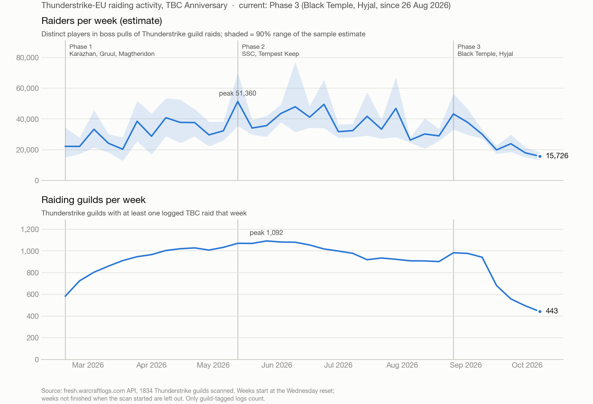

# wcl-tools

Python tools for working with [WarcraftLogs](https://fresh.warcraftlogs.com) data for WoW TBC Anniversary:
rebuilding combat log files from uploaded reports, and tracking raiding activity on a realm.

## Sub-projects

| Folder | What it does | Docs |
|---|---|---|
| [`recovered/tools/`](recovered/tools/) | Rebuild `WoWCombatLog-*.txt` files from uploaded reports, archive all raids of a character, list reports and fights, and split, summarise, or edit logs. | [README](recovered/tools/README.md) |
| [`thunderstrike-stats/`](thunderstrike-stats/) | Weekly raiding guilds and estimated raiders on Thunderstrike-EU, with phase markers. Resumable collection, progress display, chart and CSV. | [README](thunderstrike-stats/README.md) |

`thunderstrike-stats` reuses the API helper in `recovered/tools/wcl.py`, so keep the two folders in this layout.



## Setup

1. Create an API client at https://fresh.warcraftlogs.com/api/clients/ (redirect URL `http://localhost`,
   "Public Client" unchecked).
2. Put the credentials in a `.env` file in the repo root:
   ```
   WCL_CLIENT_ID=...
   WCL_CLIENT_SECRET=...
   ```

The recovery tools need only Python 3 and its standard library. The stats chart also needs matplotlib; see the
[stats README](thunderstrike-stats/README.md).

## Quick start

```sh
# rebuild the combat logs of a report
cd recovered
python3 tools/recover.py https://fresh.warcraftlogs.com/reports/ABC123xyz

# preview, then archive, every raid night of a character
python3 tools/archive_character.py MyCharacter --dry-run
python3 tools/archive_character.py MyCharacter

# collect the realm statistics and draw the chart (can take many hours)
cd ../thunderstrike-stats
./run_all.sh --bg
python3 scripts/progress.py --watch
```

## What is not in this repo

`.gitignore` is an allowlist. Combat logs, downloaded data and credentials (`.env`, the token cache) stay local.
